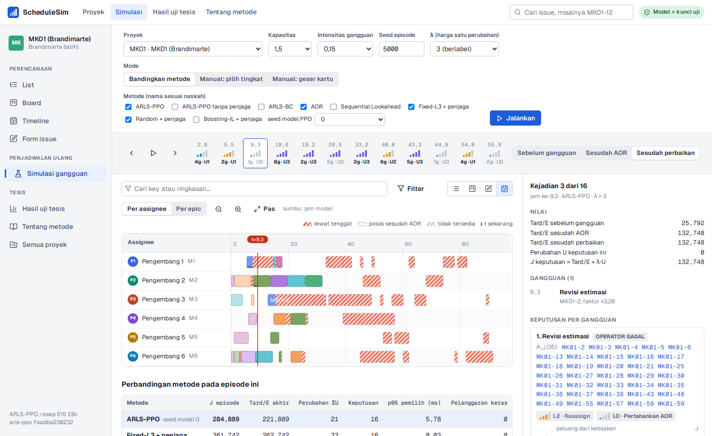
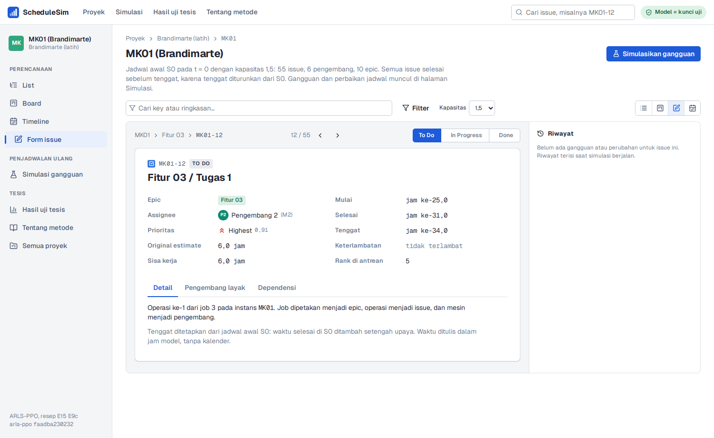

# ScheduleSim

Simulator penjadwalan ulang proyek perangkat lunak dengan tampilan alat manajemen proyek
(List, Board, Form, dan Timeline). Simulator ini memperagakan metode **ARLS-PPO** dari tesis
*Mekanisme Dynamic Rescheduling Berbasis Proximal Policy Optimization dengan Representasi Keadaan
Teragregasi untuk Manajemen Proyek Perangkat Lunak* (Universitas Gadjah Mada, 2026).

*A project-management style simulator for the ARLS-PPO rescheduling method. Every scheduling
number comes from the thesis code and the locked models in
[arls-ppo](https://github.com/stephenprasetyachrismawan/arls-ppo).*



## Selaras dengan tesis

ScheduleSim tidak punya logika penjadwalan sendiri. Backend memanggil `arls_ppo` dari submodule
`vendor/arls-ppo`, yang dikunci ke satu commit repositori kode tesis.

- **Kode episode sama dengan uji tesis.** Episode dijalankan dengan `cek_episode.run`, fungsi yang
  dipakai `buka_uji.py` saat data uji dibuka. Lingkungan, gangguan TAWOS, tangga perbaikan,
  38 angka keadaan, penjaga, J, dan pemeriksa jadwal semuanya dari kode itu.
- **Model sama dengan uji tesis.** Sebelum model dimuat, SHA-256 setiap berkas dibandingkan
  dengan dokumen kunci uji (19 November 2026); berkas yang berbeda ditolak. Statusnya tampil di
  bilah atas ("Model = kunci uji") dan di halaman Tentang metode.
- **Selisih 0,0.** Di repositori arls-ppo, hasil episode pada seed validasi sama persis dengan
  hasil validasi E15 yang tersimpan. Jejak yang ditampilkan simulator diuji tidak mengubah hasil
  untuk kedelapan metode.
- **Data uji tetap terkunci.** MK03, MK04, MK09, 35 benchmark uji, dan seed uji
  (10000-10009, 11000-11004) tidak bisa disimulasikan. Hasil ujinya hanya dibaca dari berkas hasil
  Bab V di halaman *Hasil uji tesis*.
- **Nama dan angka mengikuti naskah:**
  - nama metode: ARLS-PPO, ARLS-PPO tanpa penjaga, ARLS-BC, AOR, Sequential Lookahead,
    Fixed-L3 + penjaga, Random + penjaga, Boosting-IL + penjaga;
  - λ 0,1 / 0,3 / 1 / 3 / 10 / 30;
  - kapasitas 1,0 / 1,5 / 2,0;
  - intensitas 0,05 / 0,15 / 0,30;
  - waktu dalam jam model, tanpa kalender.

## Pemetaan tesis ke tampilan

| Tampilan | Tesis |
|---|---|
| Project | instans (MK latih, benchmark latih atau validasi, atau proyek sendiri) |
| Epic | job; tugas dari pekerjaan tidak terencana masuk Epic "Pekerjaan tidak terencana" |
| Issue | operasi (tugas) |
| Assignee | pengembang (mesin); tab *Pengembang layak* berisi upaya per pengembang |
| Original estimate | upaya pada pengembang yang ditugaskan (jam) |
| Due | tenggat d_i dari S0 (selesai + setengah upaya) |
| Status | To Do / In Progress / Done pada waktu t; Reopened sesudah review gagal |
| Rank | posisi di antrean pengembang |
| Riwayat | lima jenis gangguan dan setiap perubahan yang dihitung; banyaknya sama dengan U |

## Halaman

- **Proyek dan view.** Ada empat view yang bisa diganti dari ikon di kanan atas:
  - List: group by, urut kolom, total;
  - Board: swimlane per assignee;
  - Form: statusbar, tab, dan riwayat;
  - Timeline: baris per assignee atau per epic, tenggat, dan dependensi.
- **Simulasi gangguan.** Pilih proyek, kapasitas, intensitas, seed, λ, dan metode, lalu tekan
  Jalankan. Strip kejadian menampilkan tingkat perbaikan yang dipakai (glyph tangga L0-L3). Setiap
  kejadian bisa dilihat dalam tiga fase: sebelum gangguan, sesudah AOR, dan sesudah perbaikan.
  Panel keputusan menampilkan:
  - A_j;
  - peluang tiap tingkat dari kebijakan;
  - J tiap tingkat;
  - putusan penjaga;
  - 38 angka keadaan;
  - perubahan yang dihitung.
- **Manual.** Ada dua mode, dan keduanya dibandingkan dengan ARLS-PPO dan AOR pada gangguan yang sama:
  - *pilih tingkat*: Anda memilih L0-L3 untuk setiap gangguan;
  - *geser kartu*: Anda menggeser kartu di Board. Setiap geseran diperiksa dengan aturan
    kelayakan tesis, dan yang melanggar ditolak beserta kode aturannya.
- **Proyek sendiri.** Buat epic, issue, upaya per pengembang, dan tautan lewat form. Proyek ini
  melewati transformasi yang sama dengan instans tesis. Kebijakan dilatih pada tujuh instans
  Brandimarte, jadi proyek sendiri berada di luar data latihnya. Dua contoh fiktif (Toko daring,
  Kedai kopi) sudah tersedia.
- **Hasil uji tesis** dan **Tentang metode.** Halaman ini berisi:
  - klaim utama dengan selang 98,75%;
  - semua λ;
  - butir 1;
  - indikator I-1 dan I-2;
  - tabel hash model.

| Board | Form | Hasil uji |
|---|---|---|
|  |  |  |

## Menjalankan

Kloning beserta submodule (berisi model, sekitar 70 MB):

```bash
git clone --recurse-submodules https://github.com/stephenprasetyachrismawan/ScheduleSim
cd ScheduleSim
```

**Lokal** (Python 3.11 atau lebih baru, Node 22):

```bash
./jalankan.sh            # lalu buka http://127.0.0.1:8000
```

Saat pertama dijalankan, skrip ini memasang pustaka dengan versi yang sama dengan run tesis (torch
CPU) dan membangun frontend.

**Docker:**

```bash
ARLS_PPO_COMMIT=$(git -C vendor/arls-ppo rev-parse --short=12 HEAD) docker compose up --build
```

Pengaturan lewat variabel lingkungan:

- `SCHEDULESIM_WORKERS`: banyak proses pekerja, bawaan 4;
- `SCHEDULESIM_DATA`: folder proyek sendiri dan cache hasil.

## Pengembangan

```bash
cd backend && .venv/bin/python -m pytest          # proyeksi, API, jejak episode nyata
cd frontend && npm run dev                        # Vite di :5173, proxy /api ke :8000
cd frontend && npm test                           # filter, pengelompokan, format angka
cd e2e && npx playwright test                     # empat view, simulasi, angka layar = API
```

Struktur:

| Folder | Isi |
|---|---|
| `vendor/arls-ppo` | submodule kode, model, dan hasil tesis (dikunci per commit) |
| `backend/schedulesim` | `projection` (tesis ke konsep PM), `runner` (proses pekerja dan cache), `api` (FastAPI), `catalog`, `store` |
| `frontend/src` | React + TypeScript: `components/views` (List, Board, Form, Gantt), `pages` (Simulasi, Hasil uji, Metode, editor proyek) |
| `e2e` | tes Playwright dan skrip tangkapan layar |

Tampilan bergaya alat manajemen proyek pada umumnya. Komponen, ikon, warna, dan nama ScheduleSim
dibuat sendiri, tanpa aset atau merek produk lain.

## Lisensi

MIT. Data instans dan model: lihat README [arls-ppo](https://github.com/stephenprasetyachrismawan/arls-ppo).
